# Connected workflow: audit, workflow map and gap list

Audit of the repo at `8332eb9` (before the connection work). Stack unchanged: vanilla HTML/CSS/JS,
`server.py` (stdlib `http.server`), SQLite, `print_agent.py`.

## 1. What already exists (and is good)

The backend is further along than the portals suggest. Do not rewrite it.

- **Server-side order lifecycle** with conditional `UPDATE … WHERE status=…` (race-safe), all inside
  `BEGIN IMMEDIATE` transactions: pay → print → packed → out for delivery → delivered.
- **Durable print jobs** (`print_jobs`, claim/result by the print agent, retry on failure).
- **First-accept-wins** assignment: `deliveries.order_id` is the primary key, insert is `ON CONFLICT DO NOTHING`.
- **Delivery OTP**: HMAC of a per-delivery nonce, 4 digits, 2 h expiry, 3 attempts, admin renew; shown
  only to the signed-in owner of the order (`customer_delivery`), never in the partner API.
- **Versioned pricing** (`pricing_versions`) and a stored price snapshot (`details.bill`) per order.
- **Audit table** (`audit`: actor, action, order_id, created) written in the same transactions.
- Razorpay (webhook-verified capture, refunds), test-payment mode, Google/email/phone sign-in, email worker.

## 2. Workflow map (as built)

```mermaid
stateDiagram-v2
    [*] --> pending: customer creates order (server prices it)
    pending --> paid: Razorpay webhook / test payment
    paid --> printing: warehouse PRINT (job queued)
    printing --> packed: print agent reports every file done  (= READY)
    packed --> packed: partner ACCEPT (row in deliveries; status unchanged)
    packed --> out_for_delivery: partner PICKUP (OTP created)
    out_for_delivery --> delivered: partner enters OTP (3 tries, 2 h)
    paid --> cancelled: admin cancel (no captured payment)
    paid --> refund_pending: admin refund
    refund_pending --> refunded: Razorpay refund.processed
    refund_pending --> refund_failed: Razorpay refund.failed
```

| Step | Who | API | Portal screen |
|---|---|---|---|
| Quote | customer | `POST /api/checkout/quote` | `/upload` checkout |
| Create order | customer (email sign-in) | `POST /api/orders`, `POST /api/orders/<id>/files/<n>` | `/upload` |
| Pay | customer | `POST /api/orders/<id>/payment` (`/test-payment` in test mode), `POST /api/webhooks/razorpay` | checkout |
| Queue | warehouse | `GET /api/staff/orders` (polled) | `/warehouse` Print Queue |
| Print | warehouse → agent | `POST /api/staff/orders/<id>/print/all`; agent: `/api/print-agent/claim`, `/jobs/<id>/file`, `/jobs/<id>/result` | Order station |
| Ready | system | inside `…/result` (`ready_printed_orders`) | Ready tab |
| Offer / accept | partner | `GET /api/partner/orders` (polled), `POST …/accept` | `/partner` cockpit |
| Pickup + OTP | partner | `POST …/pickup` | cockpit |
| Track | customer | `GET /api/orders/<id>` + per-order SSE `…/events` | `/orders` |
| Deliver | partner | `POST …/deliver {code}` | cockpit OTP keys |
| Money | admin | `GET /api/admin`, `/api/admin/ledger` | `/admin` |

## 3. Gap list (what is missing or inconsistent)

| # | Gap | Where | Severity |
|---|---|---|---|
| G1 | No `order_events` table. `audit` has no from/to status, so timelines/notifications are inferred from action names | `fulfillment.py` | high |
| G2 | State machine is scattered over ~25 SQL strings; `TRANSITIONS` in `order_rules.py` covers only 2 roles. Nothing at the DB level stops an illegal jump | `server.py`, `fulfillment.py`, `razorpay_checkout.py` | high |
| G3 | Statuses/labels/colours are re-implemented per portal (raw `status.replaceAll('_',' ')` in admin, buckets in warehouse, own labels in partner and customer) | all four portals | high |
| G4 | No shared realtime feed. Warehouse polls 5 s, partner 5 s, admin 10 s; customer has a per-order SSE that polls the DB every 2 s and stops after 24 s | `warehouse.js`, `partner.js`, `operations.js`, `server.py::order_events` | high |
| G5 | Customer never gets a "printing" notification: `queue_job` writes action `print_queued`, but the notification filter looks for `printing` | `server.py::customer_notifications` | medium |
| G6 | Emails: no OTP in the out-for-delivery email; cursor is on `audit` action names | `send_order_updates.py` | medium |
| G7 | Roles: sign-in is per portal (one portal cookie). A person with several roles must sign in again to switch; no "switch portal" menu; logout clears portal + partner sessions but not the customer session | `customer_auth.py`, `server.py` | medium |
| G8 | Preview routes (`?preview=1`, `/admin-preview.html`) are served on every origin, including production | `server.py` | medium |
| G9 | No admin revenue/profit/partner-earnings figures except Razorpay "captured" (which is 0 in test mode) | `server.py::admin_snapshot`, `operations.js` | high |
| G10 | No undeliverable and no re-assign path. Refund only from `paid` | `fulfillment.py`, `server.py::refund_order` | medium |
| G11 | No local refund in test mode (needs Razorpay), so refunds cannot be exercised locally | `server.py::refund_order` | medium |
| G12 | No way to test all portals locally: sign-in needs Google, SMTP or Twilio | repo | high |
| G13 | No end-to-end test of one order through all portals | tests | high |
| G14 | `PRINTBEE_ORIGIN` is correct but undocumented for dual local/production use; `localhost` vs `127.0.0.1` silently breaks cookies/CSRF | docs, `server.py` | low |
| G15 | Print agent has no dry-run mode | `print_agent.py` | low |

## 4. Data sources: live vs sample vs browser-only

| Place | What it holds | Live? | Verdict |
|---|---|---|---|
| `server.py` / SQLite | orders, files, jobs, deliveries, earnings, pricing, audit | live | single source of truth |
| `partner.js` (`?preview=1`) | seeded sample orders, `localStorage printbee-partner-hive` | sample | preview only; gated server-side (G8) |
| `warehouse.js` (`?preview=1`) | `makeSamples()` orders, mock printer | sample | preview only; gated (G8) |
| `admin-dashboard.js`, `admin-data.js`, `pricing-preview.js` | fixtures, `localStorage` theme/pricing preview | sample | preview only; gated (G8) |
| `profile.js` | customer name/phone/address in `localStorage` | browser-only | form prefill, not order data; acceptable |
| `studio.js` | `sessionStorage` checkout draft | browser-only | UI draft; the server re-prices every order |
| `warehouse.js`, `admin-*`, `partner.js` | theme / sound / sidebar preferences | browser-only | UI preferences |

No live order, price or status is stored in the browser.

## 5. Decisions that differ from the brief (flagged for you)

1. **`READY` is stored as `packed`; `PRINTED`, `ASSIGNED` and `PICKED_UP` are derived stages.** The
   repo deliberately collapsed the manual pack step ("Move completed warehouse prints directly to
   ready") and records assignment in `deliveries`. I keep the stored statuses (no data migration, no
   UI regression) and expose the brief's stage names through the shared status model and events.
2. **Guest checkout is not supported by the backend** (ordering needs an email sign-in). "Guest" on
   the welcome page means browsing without an account. Left as is.
