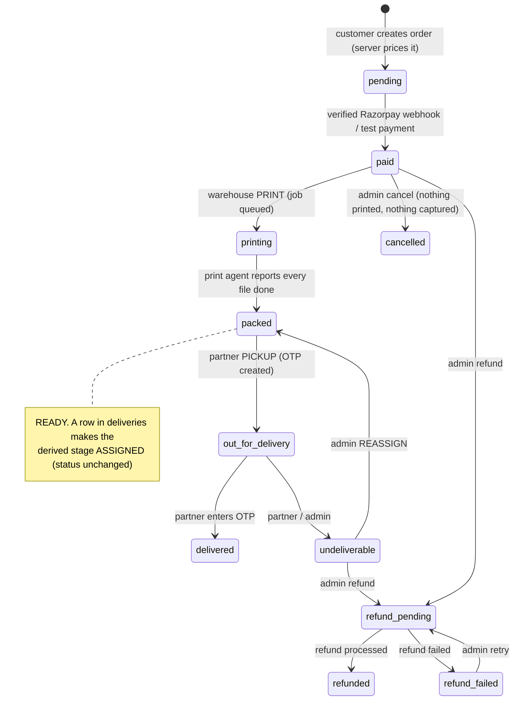

# Connected portals: how one order travels through PrintBee

One database (SQLite) is the single source of truth. Every portal reads and writes it through
`/api` endpoints. Status rules live in one file (`order_status.py`) and are enforced by the server
and by the database itself.

## 1. Status model



| Stored status | Label (every portal) | Stage (brief) |
|---|---|---|
| `pending` | Awaiting payment | PENDING |
| `paid` | Paid | PAID |
| `printing` | Printing | PRINTING |
| `packed` | Ready for pickup | READY (ASSIGNED once a partner accepts) |
| `out_for_delivery` | Out for delivery | OUT_FOR_DELIVERY (covers PICKED_UP) |
| `delivered` | Delivered | DELIVERED |
| `undeliverable` | Undeliverable | UNDELIVERABLE |
| `cancelled`, `refund_pending`, `refunded`, `refund_failed` | Cancelled, Refund pending, Refunded, Refund needs assistance | |

* One definition: `order_status.py` (`STATUSES`, `TRANSITIONS` with who may cause each change).
* Served to the portals as `GET /api/status-model`; `status-model.js` / `status-model.css` give every
  portal the same label, wording and badge colours (day and night).
* **Enforced twice:** endpoints check the caller's role; SQLite triggers (`install_guards`) reject any
  illegal jump no matter which code path attempts it (`UPDATE orders SET status='delivered'` on a paid
  order fails). New orders can only be inserted as `pending`.
* `PRINTED`, `ASSIGNED` and `PICKED_UP` from the brief are *derived stages / events*, not stored statuses
  (the repo already treats "all files printed" as ready and records assignment in `deliveries`).

## 2. Step → API → portal screen

| # | Step | Actor | API | Screen | Event written |
|---|---|---|---|---|---|
| 1 | Quote | customer | `POST /api/checkout/quote` | Upload → checkout | |
| 2 | Create order + files | customer (signed in) | `POST /api/orders`, `…/files/<n>` | Upload | `order_created` |
| 3 | Pay | customer / Razorpay | `POST …/payment` (`/test-payment` in test mode), `POST /api/webhooks/razorpay` | checkout | `paid` |
| 4 | Queue (instant) | warehouse | live feed + `GET /api/staff/orders` | Warehouse › Print Queue | |
| 5 | Print | warehouse → agent | `POST /api/staff/orders/<id>/print/all`; agent `claim`, `jobs/<id>/file`, `jobs/<id>/result` | Order station | `print_queued`, `print_done` / `print_failed` |
| 6 | Ready | system | inside the agent's `result` call | Ready tab, partner list | `packed` |
| 7 | Offer / accept | partner | live feed + `GET /api/partner/orders`, `POST …/accept` (first wins) | Partner cockpit | `delivery_accepted` |
| 8 | Pickup + OTP | partner | `POST …/pickup` | cockpit | `delivery_picked_up` |
| 9 | Track | customer | `GET /api/orders/<id>` (+ live feed) | Orders | |
| 10 | Deliver | partner | `POST …/deliver {code}` | cockpit OTP keys | `delivery_completed` |
| 11 | Money | admin | `GET /api/admin` (`finance`), `/api/admin/ledger` | Admin overview | |
| – | Cancel / refund | admin | `POST /api/admin/orders/<id>/cancel`, `…/refund` | Admin orders | `order_cancelled`, `refund_requested`, `refund.processed` |
| – | Undeliverable / reassign | partner, admin | `POST …/undeliverable`, `POST /api/admin/orders/<id>/reassign` | cockpit, Admin orders | `delivery_undeliverable`, `delivery_reassigned` |
| – | Renew OTP | admin | `POST /api/admin/orders/<id>/renew-code` | Admin orders | `delivery_code_renewed` |

**Delivery code (OTP):** created at pickup; 4 digits (HMAC of a per-delivery nonce); 3 attempts; 2 hour
expiry; admin can renew. It is returned only to the signed-in owner of the order (tracking page and the
out-for-delivery email). It is never in the partner API, the admin API or the live feed.

## 3. Event log and live feed

* `order_events` (order, event, actor, from_status, to_status, time). `fulfillment.audit()` writes it in the
  same transaction as every change, so timelines, notifications, emails and the audit view share one record.
  Event ids equal audit ids (one monotonic sequence).
* `GET /api/events?as=<admin|warehouse|partner|customer>` is a Server-Sent Events stream with
  `Last-Event-ID` catch-up, a 15 s keep-alive and a 5 minute cycle (the browser reconnects by itself).
  `&poll=1[&since=<id>]` returns the same events as JSON (the polling fallback).
* Filtering is done on the server. Admin and warehouse see everything; a customer sees only their own
  orders (no staff identities); a partner sees the ready pool and their own deliveries. Payloads carry
  order id, number, event, status change and time only: never addresses, phone numbers or codes.
* `live.js` is the client. Portals re-read their own state on every event (the feed only says "something
  changed"), after a reconnect, and on a slow safety timer (30 to 60 s).

## 4. Pricing and fees

Admin prices are versioned (`pricing_versions`). New quotes and orders use the latest version; each order
stores its own bill snapshot (`details.bill`), so old orders never change. A stale quote is refused
(`pricingChanged`). Packing, platform, delivery (flat and per km), surge and tax come from admin settings.

## 5. Admin money figures (`finance.py`, shown in the admin overview)

* **Revenue**: bill totals of orders that are paid and not refunded or cancelled (tax included).
* **Profit**: delivered sales excluding tax, minus partner earnings accrued on those deliveries. It does not
  include paper, toner or rent, which PrintBee does not record.
* **Partner earnings**: accrued and unsettled; **Refunded**: total of refunded orders.

## 6. Notifications

In-app (the Orders page, instantly) and email (`python send_order_updates.py`, needs SMTP and an HTTPS
origin) are both built from real status changes: paid, printing, ready, partner assigned, out for delivery
(email includes the code), delivered, cancelled, undeliverable, refund requested/processed/failed.
Wording comes from the status model, so it matches the portals.

## 7. Accounts, roles and logout

* Welcome page sign-in routes by role (admin, then warehouse, then partner, else customer).
* `GET /api/auth/me` lists the portals the signed-in person actually holds; `POST /api/auth/switch` opens
  one without signing in again. The "Switch portal" menu is rendered only for roles the person has.
* One logout (`/api/auth/portal/logout` or the customer sign-out) ends the customer, staff-portal and
  partner sessions and clears all three cookies.
* `/warehouse`, `/partner`, `/admin` serve only a sign-in screen to signed-out visitors; every data
  endpoint answers 401/403. Sample-data screens (`?preview=1`, `/admin-preview.html`) are served only when
  `PRINTBEE_ORIGIN` is local (or `PRINTBEE_ALLOW_PREVIEW=1`); they use sample data and never touch live orders.

## 8. Configuration: local vs production

`PRINTBEE_ORIGIN` is the one public URL. Cookies (`Secure` on https), the same-origin (CSRF) check, the
Google redirect URI (`<origin>/api/auth/google/callback`) and email links all derive from it.

| | Local | Production |
|---|---|---|
| `PRINTBEE_ORIGIN` | `http://127.0.0.1:4188` | `https://printbee.co.in` |
| Open the site at | exactly `http://127.0.0.1:4188` (`localhost` redirects there) | `https://printbee.co.in` |
| Google OAuth redirect URIs | add `http://127.0.0.1:4188/api/auth/google/callback` | add `https://printbee.co.in/api/auth/google/callback` |
| Payments | `PRINTBEE_PAYMENT_MODE=test` or `disabled` | `razorpay` (webhook → `/api/webhooks/razorpay`) |
| Sample-data screens | allowed | redirected to the real portals |
| Demo sign-in | `python demo.py` | refused (demo mode requires a local origin and test payments) |

`localhost` and `127.0.0.1` are different origins to a browser: cookies set on one are not sent to the other,
so a local server redirects the wrong one to the configured origin instead of failing silently.

## 9. Demo mode

```bash
python demo.py --reset      # test payments, mock print agent, local-only demo database in .demo-data/
```

Open `http://127.0.0.1:4188/` and use **Local demo: sign in as** (customer, warehouse, two delivery
partners, admin, and one identity with every role). Use two browsers or a private window to be signed in
as two roles at once. The mock printer runs the real agent loop but does not call a spooler. To run a real
agent use `print_agent.py --printer <name>`; `--mock-printer` is the dry run.

## 10. Tests

```bash
python -m unittest discover -p "test_*.py"     # 44 tests
python -m unittest test_e2e_workflow -v        # the end-to-end journey (starts its own server)
```

`test_e2e_workflow.py` plays every role over HTTP against a real server and database: customer →
test payment → warehouse print (mock printer) → ready → partner accept → pickup → OTP → deliver → admin
revenue/profit/earnings, plus wrong OTP ×3 and renewal, refund, cancel, two partners accepting at the
same instant, a price change after ordering, illegal transitions (API and database), undeliverable and
reassign, role-filtered live events with catch-up, switch portal and logout, and the production-origin rules.
